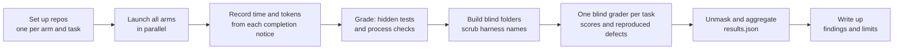

# How the exploratory rounds were run

This page records the whole process behind [iteration 3](experiments/2026-10-10-harness-vs-oneshot.md)
and [iteration 4](experiments/2026-10-12-iteration-4.md), so that someone can repeat it, check it, or
port it into the Harbor live tier. It also records what went wrong, because several problems
changed the results and the next design.

## 1. The loop

## 2. Steps

0. **Build the workspace.** [`make_workspace.sh`](experiments/2026-10-12-iteration-4/make_workspace.sh)
   copies the fixture and the hidden tests from `golden/tasks/T0[456]*` and the scripts into one folder.
1. **Fix the tasks.** Three feature requests for `ledgerlite` (a ~300-line Python CLI: models, JSON
   storage, CSV importer, reports, argparse CLI). They are T04–T06 in `golden/tasks/`. Each has a
   hidden test suite that fails on the untouched repository and passes with the reference patch
   (`python -m cbench golden-check`).
2. **Set up one repository per arm and task.** [`setup_iteration.sh`](experiments/2026-10-12-iteration-4/setup_iteration.sh)
   copies the fixture, makes the "ledgerlite baseline" commit, and gives each arm a local bare
   `origin`. Every arm starts from the same tree.
3. **Write the prompts.** Harness arms get Template H (skill path, slash command, task text,
   repository, outputs, environment). One-shot arms get Template B: Template H with the skill line,
   the slash command and every pipeline word removed. Nothing is added. The task text is the same,
   word for word, for every arm ([criteria §2](criteria.md)).
4. **Launch every arm at once.** Each arm is a Claude Code `general-purpose` subagent with the same
   tools. Harness arms ran on Opus 5.5. One-shot arms ran on Opus 5.5, Sonnet 5.5 and Haiku 4.5.
5. **Record cost when each run ends.** The completion notice gives wall time and the run agent's
   token count. That is the only chance to capture it, so a `timing.json` goes next to the run at
   once.
6. **Grade.** [`grade.py`](experiments/2026-10-12-iteration-4/grade.py) runs the hidden tests on the
   delivered tree and the process checks C1–C10 (plan, reviews, phases, commits, questions to the
   user, and similar). It compares against the baseline commit, not `origin/main`, because some runs
   push to `main`.
7. **Build blind folders.** [`build_blind.py`](experiments/2026-10-12-iteration-4/build_blind.py)
   gives each arm a random letter per task. It copies the final `ledgerlite/`, `tests/`, `README.md`
   and `pyproject.toml` from the **delivered working tree** (committed or not), and a diff from the
   baseline. It removes harness names, ticket ids, phase labels and review finding ids from the text,
   then runs each folder's own tests to prove the scrub broke nothing.
8. **Grade blind.** One Opus grader per task sees all folders side by side. It scores design,
   correctness, readability and tests (1–10), and must reproduce each defect with a command and its
   output. The letter map stays outside the folders. We then classify each reproduced defect by a
   written rule ([`defects.json`](experiments/2026-10-12-iteration-4/defects.json)).
9. **Unmask and aggregate.** A script joins the blind scores, hidden tests, process checks, time,
   tokens and the audit-trail counts into [`results.json`](experiments/2026-10-12-iteration-4/results.json)
   and [`auditability.json`](experiments/2026-10-12-iteration-4/auditability.json).
10. **Write up.** Results, findings, and the confounds next to the claims they limit.

## 3. What went wrong, and what it taught us

| Problem | Effect | What changed |
|---|---|---|
| A Cadence change (cadence#52) wrote the orchestrator note to the subagent's Bash working directory, which Claude Code resets to the parent's project (cadence#56) | 2 of 3 Cadence runs lost their note. Every peer gate then failed closed. The runs stopped with a recorded reason and did not report success | Fixed in cadence#57 after two review rounds. Those two tasks ran again on the fix. The pre-fix runs are reported apart |
| User-level skills with the same names as Cadence's peers ran instead of the peers (cadence#53) | Peers wrote reports in the wrong shape. Orchestrators had to send each peer the bundled path | Next design: a clean `HOME` per run |
| The host sandbox denied reads of `~/.cursor/skills/_shared` | ship-feature ran some of its gate scripts by hand | Next design: a clean environment per run |
| Two Haiku runs never committed their work | A branch archive would have graded the untouched baseline | Blind folders now use the delivered working tree, as criteria v1 already requires for grading |
| The first scrub left phase labels and finding ids in comments | Those labels would have shown which folders came from a harness | Extra scrub rules. `build_blind.py` now ends with a search for harness words and fails if one is left |
| A review agent ran `install.sh --help`, and the script has no help flag | It changed the live install of the skill. The host blocked its attempt to undo this | The owner restored the links. Lesson: an installer must reject unknown flags |
| Every session was shown the 96 user-level skills, some described as TDD | The one-shot baselines were exposed to skill descriptions. None used a skill (checked) | A clean `HOME` per run and `clean_room_check.py` as a gate before grading |
| The completion notice reports total tokens only | No dollar figures | Next design: record input, output and cache tokens per session |
| GitHub Actions did not start (an account billing block) | The two Cadence fixes merged on local test evidence, by owner decision | Recorded on each PR |

## Clean room

A run counts only if it saw and used nothing but its own arm's tools. Iterations 3 and 4 did not meet
that bar. Every Claude Code session is shown the names and descriptions of every user-level skill, and
on this host that list had 96 skills, some described as "strict TDD discipline". A one-shot baseline
that can see such a list is not neutral ([criteria §2](criteria.md#2-arms)), and a description can also
fire a skill on a wake word.

[`scripts/clean_room_check.py`](../scripts/clean_room_check.py) reads a run's transcript and returns:

| Verdict | Exit | Meaning |
|---|---|---|
| `clean` | 0 | No skill outside the arm's allowlist was listed or used |
| `exposed` | 1 | Skills outside the allowlist were listed to the session, and none was used |
| `contaminated` | 2 | A skill outside the allowlist was called, or a skill, rule, command or memory file was read |

From the next run set on, a run is graded only when the check returns `clean`. Each run gets a clean
`HOME` with only its arm's harness installed, so a harness arm's own files are the only ones that can
appear, and the check is exact.

**Iteration 4, checked after the fact** ([`clean_room.json`](experiments/2026-10-12-iteration-4/clean_room.json)):
all 9 one-shot runs were `exposed` (96 skills listed) and none was `contaminated`: no one-shot called a
skill or read a skill, rule or command file. The harness runs cannot be judged from their transcripts:
path matching cannot tell their own bundled files from user-level ones, and their peer agents'
transcripts, where cadence#53 substitutions happened, were not kept.

## 4. Rules we kept

- **The baseline prompt adds nothing.** No "use TDD", no "write tests", no quality words.
- **A claim in an agent's own summary is not evidence.** Hidden tests, the blind grader's reproduced
  defects, and files on disk are.
- **Results against the harness are reported the same way as results for it.** Iteration 4 shows no
  quality gain from a harness, and the docs say so first.
- **Confounds go next to the claims they limit,** not at the end.

## 5. From here to criteria v1

These rounds ran outside this repository, one run per cell, with one grader. [Criteria v1](criteria.md)
requires 5 runs per cell, two graders, a repro script for defects, and cost from the host's own
accounting. The [next steps](next-steps.md) add those, and they ask the cost question directly.
