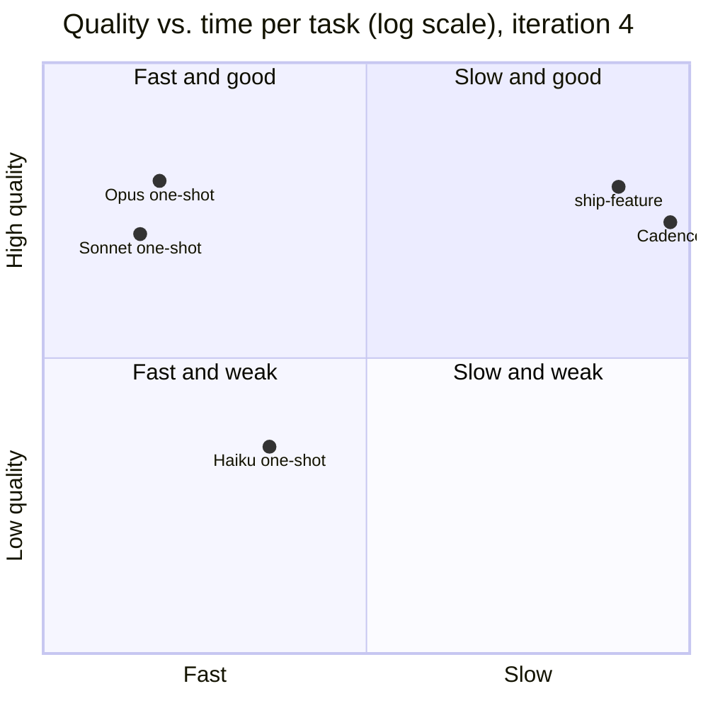

# Talk track: "Why a harness, when the model is this good?" (20 minutes)

A ready-to-present outline. Each slide has a time box, a headline, what to show, and speaker
notes. Every number comes from [findings](findings.md) and the
[iteration 4 data](experiments/2026-10-12-iteration-4/). The talk is credible because it states the
result that does not favor the harness first, and because it never claims more than one run per cell
can show.

---

## 1. The setup (0:00–1:30)

**Headline:** We gave the same feature request to Opus alone and to Opus inside our harness. Then a
blind grader judged the code.

**Show:** the three tasks (multi-currency, budgets, audit-and-undo on a small Python CLI), and the
five arms: Cadence, ship-feature, and Opus, Sonnet and Haiku alone.

**Notes:** One prompt per task, word for word the same for every arm. The one-shot prompt adds
nothing: no "use TDD", no "write tests". A grader saw anonymous folders and had to reproduce every
defect it claimed with a command. **Disclosure:** I wrote Cadence. That is why the rules were written
down before the runs, and why the result against it comes first.

## 2. The question we pre-registered (1:30–3:00)

**Headline:** Is a harness worth its cost compared with the same model alone?

**Show:** the rule from [criteria v1](criteria.md#6-decision-rule-pre-registered): a harness is worth
it only if it gives **fewer defects** or **more trustworthy evidence** at an acceptable cost. "Solves
the task" is not enough, because a model alone solved the tasks.

**Notes:** Each cell ran once, with one grader. So everything today is exploratory. The real test is
5 runs per cell and two graders.

## 3. Result 1: no quality gain from the harness (3:00–6:00)

**Headline:** On small, precise tasks, the harness did not beat the model alone, and it took about 30
times longer.

**Show:**

| Arm | Delivered | Blind quality | Time per task | Tokens |
|---|---|---|---|---|
| Opus one-shot | 3 of 3 | **8.00** | 2 min | 69k |
| ship-feature (Opus) | 2 of 3 | 7.88 | 42 min | 212k |
| Cadence (Opus) | 3 of 3 | 7.33 | 63 min | 279k |
| Sonnet one-shot | 3 of 3 | 7.08 | 2 min | 64k |
| Haiku 4.5 one-shot | 1 of 3 | 3.50 | 4 min | 71k |

**Notes:** Say it plainly: we built a harness, and on this test it did not write better code than the
model alone. Be exact: per task, the gaps between Opus alone and Cadence are +2.0, −0.5 and +0.5. Only
the first is bigger than single-run noise. So the honest line is "no gain shown", not "the harness
made it worse". Iteration 3 could not show even this, because it had no Opus one-shot.

## 4. Result 2: what the harness bought (6:00–11:30)

**Headline:** Not better average code. Four other things.

**Show, one at a time:**

1. **No crash in the delivered code.** Opus, Sonnet and Haiku alone each shipped two tracebacks on the
   budgets task, each reproduced by one command. Neither harness shipped one. Cadence's own review
   caught a similar crash before delivery and recorded the fix.
   ([`defects.json`](experiments/2026-10-12-iteration-4/defects.json))

   | Arm | Major or critical defects per run | Crashes shipped |
   |---|---|---|
   | Cadence | 0.67 | 0 |
   | ship-feature | 0.67 | 0 |
   | Opus one-shot | 1.00 | 2 |
   | Sonnet one-shot | 1.33 | 2 |
   | Haiku one-shot | 2.67 | 2 |

2. **Evidence you can audit.** Per Cadence run: a plan, a spec check, a plan review, an adversarial
   review, two test scorecards, a PR review, and a findings ledger where each must-fix finding has a
   verification. 12–23 attestation rows record which agent wrote each review, 8 to 12 different agents
   per run, and the hook stops the implementer from writing its own reviews. A one-shot leaves one
   commit. ([`cadence_attest/`](experiments/2026-10-12-iteration-4/cadence_attest/))
3. **Completion you can trust.** Cadence delivered 3 of 3. When a harness defect broke two runs, both
   stopped with a recorded reason, and neither claimed success. Two Haiku runs never committed their work,
   and nothing told anyone.
4. **Rules the model cannot skip.** Cadence's hooks block a forged approval, a self-certified verdict, an
   edit before the plan is approved and a stop mid-run (7 of 9 probes).

**Notes:** The defect gap (0.67 against 1.00) is below the 0.5 bar of our own rule, on one run. Say so.
The crash count is the clearest signal, and it comes from one task.

## 5. Result 3: what the harness did not buy (11:30–13:30)

**Headline:** It over-builds, it is slow, and it has bugs of its own.

**Show:**

- The graders marked Cadence down for scope it was not asked for, in both rounds ("heavier than
  needed").
- About 30 times the wall time and 4 times the tokens.
- A Cadence change broke two runs (cadence#56). Its own review process found and fixed it (cadence#57).
- Host setup leaks in: user-level skills replaced Cadence's reviewers (cadence#53).

**Notes:** Each of these is now a ticket or a design input. The over-building is the clearest product
gap: every addition should trace to a spec line or a recorded decision.

## 6. Why it matters more as models get stronger (13:30–16:30)

**Headline:** A stronger model makes more code that someone must trust, and it costs more.

**Show:**

- Per-token list prices: Opus 5.5 $4 / $20 per million, Haiku 5.5 $0.10 / $0.50 (for prompts up to
  100K tokens). **Up to a 40 times gap.**
- A one-shot gives you code, and you must still check it yourself. A harness gives you code plus the
  evidence that it was checked, by an agent that did not write it.
- The harness spends extra tokens on purpose: planning, independent review, verification. On a model at
  1/40 of the price, those tokens are cheap.

**Notes:** Be exact about what is shown and what is not. Shown, on one run per cell: no crashes shipped,
an audit trail, reliable completion, enforcement. Not shown: better code, fewer defects by our own rule,
or that a harness lets a cheap model match Opus. The last one is the next experiment.

## 7. Next: the cheapest model that matches Opus (16:30–19:00)

**Headline:** Find the cheapest model that, inside the harness, matches Opus alone, with an audit trail.

**Show:** the ladder from [next steps](next-steps.md): the Opus one-shot is the bar. Cadence runs on Sonnet
5.5 and Haiku 5.5, and, through the Cursor CLI, on GPT-5.4 Mini, Gemini 3.8 Flash and Composer 2.5. Each
has a one-shot partner on the same model. A mixed arm uses a cheap model to implement and Opus only to review.

**Notes:** An estimate, not a result: Cadence used about 4 times the tokens of the Opus one-shot. On a model
at 1/40 of the price, with a similar token mix, that is 1/10 to 1/5 of the Opus one-shot's cost, before
any extra tokens a weaker model needs. The decision rule is criteria v1's: fewer defects, no more false
successes, and delivery that is not worse than the Opus one-shot, with cost per defect-free run reported.

## 8. Close (19:00–20:00)

**Headline:** We did not show that a harness writes better code. We did show what it gives you.

**Notes:** Three lines to end on:

1. On small, precise tasks, if all you need is code, the strongest model alone is fast and good.
2. If you must show how the code was checked, by whom, and that the checks passed, a one-shot cannot
   give you that. The harness does it on every run. And on this data, every one-shot shipped two crashes,
   while no crash reached the harness's delivered code.
3. The next result tells us whether the harness also lets a model at 1/40 of the price do the job.

---

## Questions to expect

| Question | Answer |
|---|---|
| "Isn't n = 1 just noise?" | Yes, for most of these gaps. Only multicurrency's quality gap and Haiku's results are clearly outside it. That is why the next run uses 5 runs per cell and two graders ([criteria v1](criteria.md)). |
| "You wrote Cadence. Why trust this?" | The rules, the sample and the decision rule were written before the runs. The graders were blind. And the main result does not favor Cadence. |
| "Did you tune the prompt for the harness?" | No. The one-shot prompt is the harness prompt with the harness parts removed, and nothing added. |
| "Why didn't the harness win on quality?" | The tasks fully specify every output, so there is little for review to add. And the harness built more than asked, which the graders marked down. |
| "Then why use it?" | For the evidence trail, the enforced process, completion you can trust, and, on this data, no shipped crashes. And, if the next experiment holds, for cost. |
| "Could a one-shot just be asked to write a plan and tests?" | It could. That would be a harness in a prompt, with no independent reviewer and no enforcement. The criteria do not allow it in the baseline, so the comparison stays fair. |
| "What about the bugs in your own harness?" | Real, found during this work, fixed through the same review loop, and recorded (cadence#56, #57). They are part of the result. |
