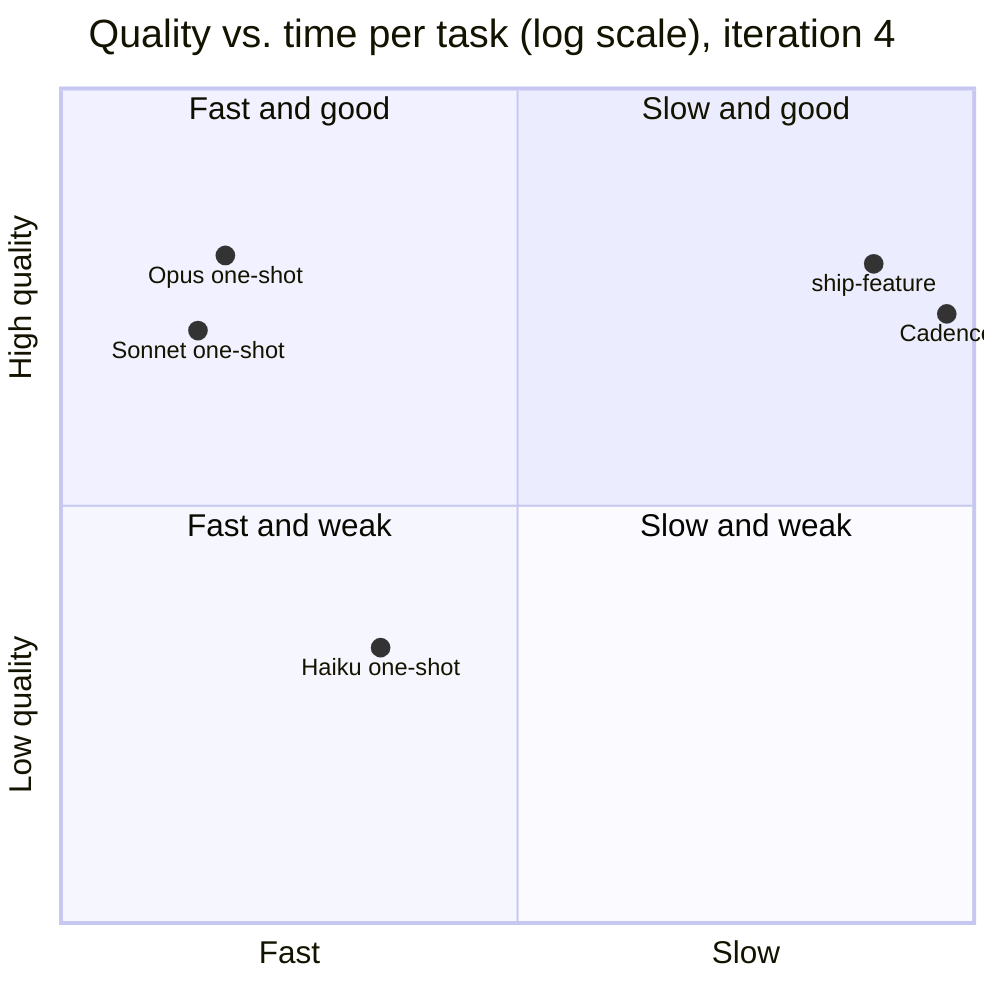

# Talk track: "Why a harness, when the model is this good?" (20 minutes)

A ready-to-present outline. Each slide has a time box, a headline, what to show, and speaker
notes. Every number comes from [findings](findings.md) and the
[iteration 4 data](experiments/2026-10-12-iteration-4/). Present the result against the harness
first: the talk is credible only because of it.

---

## 1. The setup (0:00–1:30)

**Headline:** We gave the same feature request to Opus alone and to Opus inside our harness. Then a
blind grader judged the code.

**Show:** the three tasks (multi-currency, budgets, audit-and-undo on a small Python CLI), and the
five arms: Cadence, ship-feature, and Opus, Sonnet and Haiku alone.

**Notes:** One prompt per task, word for word the same for every arm. The one-shot prompt adds
nothing: no "use TDD", no "write tests". A grader saw anonymous folders and had to reproduce every
defect it claimed with a command.

## 2. The question we pre-registered (1:30–3:00)

**Headline:** Is a harness worth its cost compared with the same model alone?

**Show:** the decision rule from [criteria v1](criteria.md): a harness is worth it only if it gives
**fewer defects** or **more trustworthy evidence** at an acceptable cost. "Solves the task" is not
enough, because a model alone solved every task.

**Notes:** We wrote the rule down before the runs that it judges. Results that go against the
harness get reported the same way as results for it.

## 3. Result 1: Opus alone wrote the best code (3:00–6:00)

**Headline:** On small, precise tasks, the model alone wins on quality, and it is about 30 times faster.

**Show:**

| Arm | Blind quality | Time per task | Tokens |
|---|---|---|---|
| Opus one-shot | **8.00** | 2 min | 69k |
| ship-feature (Opus) | 7.88 (2 of 3 delivered) | 42 min | 212k |
| Cadence (Opus) | 7.33 | 63 min | 279k |
| Sonnet one-shot | 7.08 | 2 min | 64k |
| Haiku 4.5 one-shot | 3.25 | 4 min | 71k |

**Notes:** Say it plainly: we built a harness, and on this test the model alone beat it. Iteration 3
could not show this, because it had no Opus one-shot. Iteration 4 added that control on purpose.

## 4. Result 2: what the harness bought (6:00–11:30)

**Headline:** Not better average code. Four other things.

**Show, one at a time:**

1. **Evidence you can audit.** Per Cadence run: a plan, a spec check, a plan review, an adversarial
   review, two test scorecards, a PR review, a findings ledger with every must-fix finding verified,
   12–23 rows that prove a separate agent wrote each review, and 16 gate records. A one-shot leaves
   one commit. ([`auditability.json`](experiments/2026-10-12-iteration-4/auditability.json))
2. **Review that catches what the author missed.** Cadence's reviewers raised 6 must-fix findings
   across 3 runs, and each was fixed and verified before delivery: a README example that failed, a CSV
   header that switched the currency check off, a store value that crashed. The same class of defect
   shipped in the one-shots: a NaN amount crashed Opus's budgets code.
   ([`cadence_ledgers/`](experiments/2026-10-12-iteration-4/cadence_ledgers/))
3. **Better code where the spec has the most edge cases.** Budgets: both harnesses 7.75, against Opus
   7.25, Sonnet 6.25 and Haiku 3.5 alone. Iteration 3 showed the same on audit-and-undo.
4. **It fails loudly.** When a harness defect broke two runs, both stopped with a recorded reason.
   Neither claimed success. A one-shot has no way to say "I could not prove this".

**Notes:** Add enforcement from the deterministic tier: Cadence's hooks block a forged approval, a
self-certified verdict, an edit before the plan is approved and a stop mid-run (7 of 9 probes).

## 5. Result 3: what the harness did not buy (11:30–13:30)

**Headline:** It over-builds, it is slow, and it has bugs of its own.

**Show:**

- The graders marked Cadence down for scope it was not asked for, in both rounds ("over-built for this
  change").
- About 30 times the wall time and 4 times the tokens.
- A Cadence change broke two runs (cadence#56). Its own review process found and fixed it (cadence#57).
- Host setup leaks in: user-level skills replaced Cadence's reviewers (cadence#53).

**Notes:** Each of these is now a ticket or a design input. The over-building is the clearest product
gap: every addition should trace to a spec line or a recorded decision.

## 6. Why it matters more as models get stronger (13:30–16:30)

**Headline:** A stronger model makes more code that someone must trust, and it costs more.

**Show:**

- Per-token list prices: Opus 5.5 $4 / $20 per million, Haiku 5.5 $0.10 / $0.50. **A 40 times gap.**
- A one-shot gives you code. You still have to check it yourself. A harness gives you code plus the
  evidence that it was checked, by an agent that did not write it.
- The harness spends extra tokens on purpose: planning, independent review, verification. On a model
  at 1/40 of the price, those tokens are cheap.

**Notes:** Be exact about what is shown and what is not. Shown: auditability, reliable completion,
better results on edge-case-heavy specs. Not shown yet: that a harness lets a cheap model match Opus.
That is the next experiment.

## 7. Next: the cheapest model that matches Opus (16:30–19:00)

**Headline:** Find the cheapest model that, inside the harness, matches Opus alone, with an audit trail.

**Show:** the ladder from [next steps](next-steps.md): Opus one-shot as the bar. Cadence on Sonnet
5.5, Haiku 5.5, and through the Cursor CLI on GPT-5.4 Mini, Gemini 3.8 Flash and Composer 2.5. Each
has a one-shot partner on the same model. Then a mixed arm: a cheap model implements, and Opus only
reviews.

**Notes:** Estimate, not result: Cadence used about 4 times the tokens of the Opus one-shot. On a
model at 1/40 of the price, with a similar token mix, that is 1/10 to 1/5 of the Opus one-shot's
cost. The decision rule: the cheapest arm in dollars per delivered task whose quality is within 0.5
of Opus, with no more major defects, finishing 4 of 5 runs, with a complete audit trail.

## 8. Close (19:00–20:00)

**Headline:** We did not prove that a harness writes better code. We proved what it is for.

**Notes:** Three lines to end on:

1. On small, precise tasks, use the strongest model alone if all you need is code.
2. If you must show how the code was checked, by whom, and that the checks passed, a one-shot cannot
   give you that. The harness does, every run.
3. The next result tells us whether the harness also lets a model at 1/40 of the price do the job.

---

## Questions to expect

| Question | Answer |
|---|---|
| "Isn't n = 1 just noise?" | Yes, for gaps under about 1 point. That is why the next run uses 5 runs per cell and two graders ([criteria v1](criteria.md)). The 4.75-point gap between Haiku 4.5 alone (3.25) and Opus alone (8.00) is not noise. |
| "Did you tune the prompt for the harness?" | No. The one-shot prompt is the harness prompt with the harness parts removed, and nothing added. |
| "Why did the harness lose on quality?" | The tasks fully specify every output, so there is little for review to add. And the harness built more than asked, which the graders marked down. |
| "Then why use it?" | For the evidence trail, the enforced process, the loud failures, and the edge cases. And, if the next experiment holds, for cost. |
| "Could a one-shot just be asked to write a plan and tests?" | It could. That would be a harness in a prompt, with no independent reviewer and no enforcement. The criteria forbid it in the baseline, so the comparison stays fair. |
| "What about the bugs in your own harness?" | Real, found during this work, fixed through the same review loop, and recorded (cadence#56, #57). They are part of the result. |
